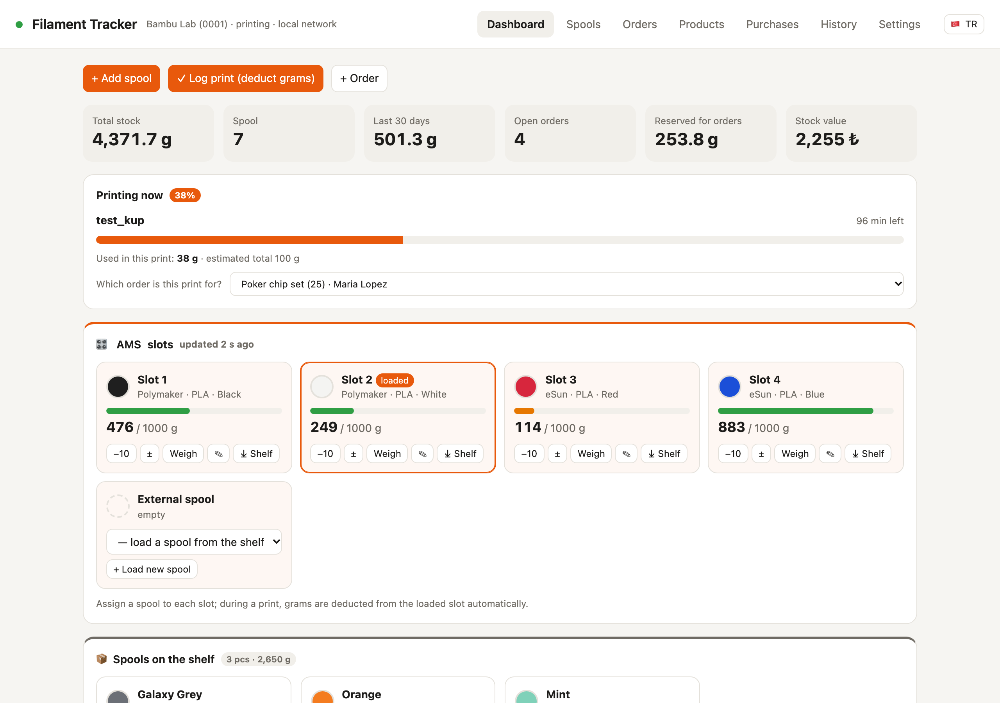
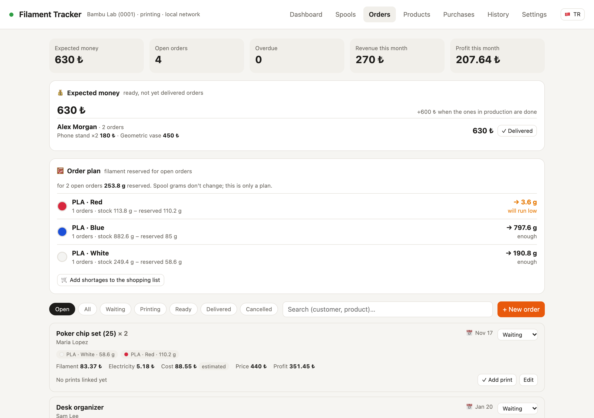
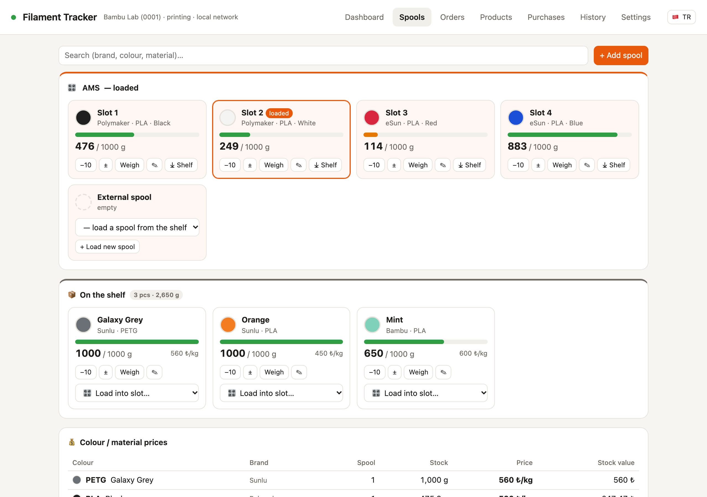
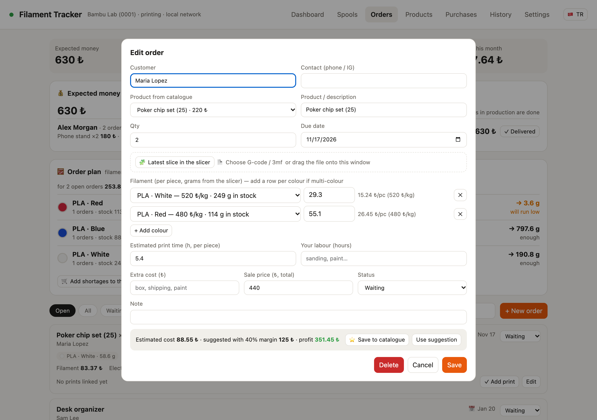
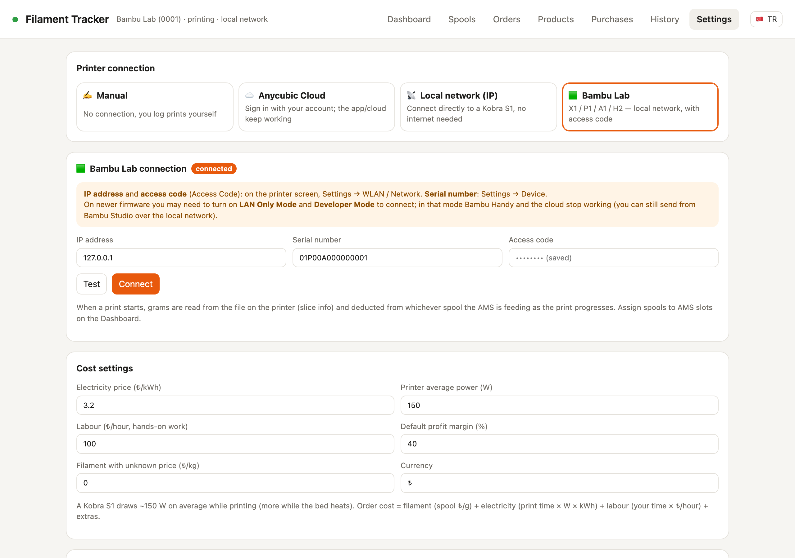
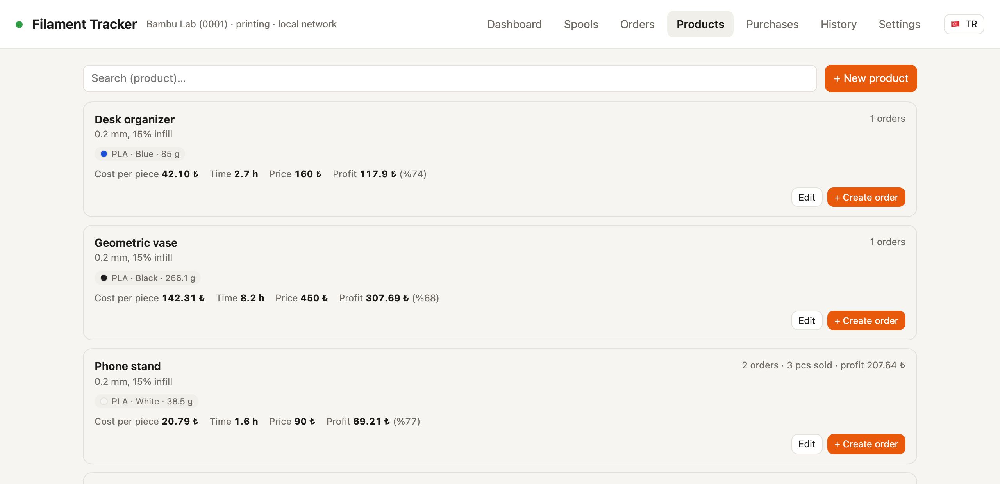

# Filament Tracker

🇬🇧 **English** · 🇹🇷 [Türkçe](README.tr.md)

Filament stock, print cost and customer-order tracking for **Anycubic Kobra S1 + ACE Pro** and **Bambu Lab (AMS)**.
Runs locally on your Mac and opens in the browser at `http://127.0.0.1:8765`. Nothing to install besides Python 3
(standard library only, no packages). The UI is available in English and Turkish — it follows your browser language
and can be switched with the EN / TR button in the top-right corner.



## Features

**Spools and stock**
- ACE Pro / AMS slots and shelf spools are shown separately; spools keep a stable order.
- While a print runs, grams are deducted automatically from the loaded slot (Anycubic Cloud, Anycubic LAN or Bambu Lab LAN).
- Works without any printer connection too: log prints by hand with "✓ Log print".
- Low-stock warnings and a per-colour / per-material price table.

**Cost**
- Cost = filament + electricity + labour + extras.
- Filament price follows the colour: the spool's own price → same colour → same material → overall average.
- Suggested sale price from the profit margin in Settings. Currency is configurable.

**Orders and product catalogue**
- Customer orders (Waiting → Printing → Ready → Delivered) with due dates and overdue warnings.
- When an order is set to "Printing", its estimated grams are deducted from stock; as real prints are linked to the
  order the estimate is given back, so nothing is counted twice (can be turned off in Settings → Preferences).
- Stock plan for open orders: "after these orders you'll have X g of red left", plus a shopping list for shortages.
- 💰 Expected money: per-customer total of orders that are ready but not delivered yet.
- Catalogue for products you print often: enter grams, time and colours once, add to an order with one click.
- Filament purchases (To buy → Ordered → Shipped → Received); received spools are added to stock with their price.

**Import from your slicer**
- Drag and drop G-code or `.gcode.3mf`: grams, colours and time are filled in and colours are matched to your spools.
- "Latest slice in the slicer" reads the job you last sliced in Anycubic Slicer Next.
- Unsliced `.3mf` projects are sliced in the background if Anycubic Slicer Next is installed (a few seconds).
- Pick a plate in multi-plate projects.

## Screenshots

| Orders and expected money | Spools and AMS slots |
|---|---|
|  |  |

| Order editor with cost estimate | Bambu Lab connection |
|---|---|
|  |  |



Names and data in the screenshots are made up.

## Install

```bash
git clone https://github.com/gulbaharr/filament-takip.git
cd filament-takip
./install.sh
```

This creates and opens `~/Applications/Filament Takip.app`; afterwards just double-click the app.
Run `./install.sh` again after changing the code.

To try it without installing: `python3 server.py` (other port: `FILAMENT_PORT=9000 python3 server.py`).

## Printer connection

All optional — without one, the app is used by hand.

| Method | How | Notes |
|---|---|---|
| **Anycubic Cloud** | Sign in at cloud-universe.anycubic.com in Chrome / Brave / Edge / Arc → Settings → "Find automatically in browser". Or run `copy(localStorage['XX-Token'])` in the browser console and paste it. | The token lasts about 90 days. |
| **LAN (local network)** | Turn on LAN Mode on the printer → Settings → enter the printer's IP → "Test" → "Connect". | Written for the Kobra S1; no internet needed. |
| **Bambu Lab** | Settings → 🟩 Bambu Lab → IP, serial number and access code (printer screen: Settings → WLAN / Device) → "Test" → "Connect". | X1 / P1 / A1 / H2. Newer firmware may need LAN Only + Developer Mode. |

How grams are calculated:
- **Anycubic:** filament length used (mm), or progress × estimated length → `length × π × 0.875² × density`.
- **Bambu:** when a print starts, the `.gcode.3mf` on the printer is read over FTPS; total grams from `slice_info` × progress.

Either way the grams come off the spool in the slot that is feeding at that moment (AMS / ACE). If the printer briefly
reports "idle", the print isn't considered finished (it waits 3 minutes); a cancelled print only deducts what was printed.

## Supported printers and slicers

| | Status |
|---|---|
| Anycubic Kobra S1 + ACE Pro | ✅ Live tracking (Cloud and LAN) |
| Other Anycubic printers (Cloud) | ⚠️ Likely works, untested |
| Bambu Lab X1 / P1 / A1 / H2 (+ AMS) | ✅ Live tracking (local network); tested against a simulated printer, not yet on real hardware |
| Prusa, Creality, etc. | ❌ No live tracking; manual logging and file import work |
| Anycubic Slicer Next, Bambu Studio, OrcaSlicer G-code / `.gcode.3mf` | ✅ Grams, colours and time are read |
| PrusaSlicer G-code | ⚠️ Same line format, expected to work; untested |
| Cura G-code | ❌ Doesn't write grams (only metres) |
| Unsliced `.3mf` | Sliced in the background if Anycubic Slicer Next is installed |

## Data

- Everything is stored in `~/Library/Application Support/FilamentTakip/data.json` (copy this file to back up).
- Log: `server.log` in the same folder.
- The data file is not in the repository (`.gitignore`).
- The server only listens on `127.0.0.1`; other devices on the network can't reach it. Write requests require an `X-Filament: 1` header.

## Files

| File | Purpose |
|---|---|
| `server.py` | HTTP server, data, Anycubic Cloud, print tracking, cost / reservations |
| `bambu.py` | Bambu Lab local connection (MQTT 8883 + FTPS 990) |
| `lan.py` | Kobra S1 LAN connection (MQTT); protocol documented by [chrisfore/anycubic_ha_local](https://github.com/chrisfore/anycubic_ha_local) |
| `slicer.py` | G-code / 3mf parsing, background slicing with Anycubic Slicer Next |
| `index.html` | The whole UI (single page), including the EN / TR dictionary |
| `install.sh` | Installs / updates the macOS app |

Cloud request signing: [Nino6689/hass-anycubic](https://github.com/Nino6689/hass-anycubic) (web mode).

## Limitations

- Only tested on macOS (`install.sh` and browser token detection are macOS-specific; `server.py` should run elsewhere).
- Doesn't run as-is on serverless hosts like Vercel: it needs a persistent file, background tracking and local network access.
- Background slicing uses the project's own settings; the slicer's command line can crash on some files.
  In that case slice it in the slicer and use "Latest slice in the slicer".
- The UI is written in Turkish and translated to English at runtime; a few rare messages may still appear in Turkish.
